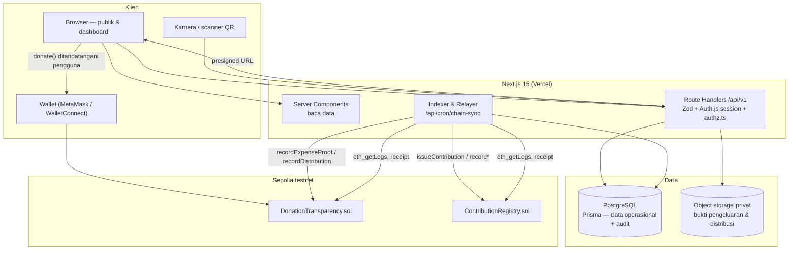
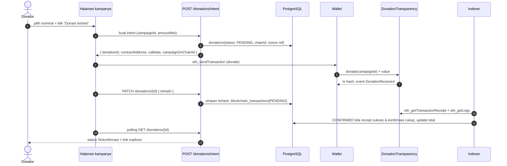

# Arsitektur Teknis — AksiBareng

Dokumen ini menjelaskan bagaimana sistem disusun, batas antara database/blockchain/storage, perilaku saat chain gagal, dan keputusan arsitektur beserta trade-off-nya. Requirement berasal dari `docs/PRD.md` §13.

## 1. Ringkasan

AksiBareng adalah **monolith Next.js full-stack** dengan empat lapisan:

1. **UI (React Server Components + Client Components)** — katalog publik, dashboard 3 role, scanner QR.
2. **Route Handlers (`/api/v1`)** — API internal, validasi Zod, otorisasi, workflow bisnis.
3. **PostgreSQL (Prisma)** — seluruh data operasional, status workflow, audit log.
4. **Lapisan chain** — dua kontrak Solidity di Sepolia, dipanggil dari klien (donasi oleh pengguna) atau dari relayer server (pencatatan kontribusi & hash bukti).

Prinsip: **chain adalah jangkar audit, bukan database.** Semua keputusan bisnis dan seluruh data pribadi hidup di PostgreSQL.

## 2. Diagram komponen

## 3. Batas data: apa di mana

| Data | Tempat | Alasan |
|---|---|---|
| Akun, sesi, role, profil | PostgreSQL | Perubahan cepat, otorisasi server-side |
| Organisasi + status verifikasi | PostgreSQL | Workflow admin |
| Kegiatan, pendaftaran, tugas, presensi | PostgreSQL | Kuota & race condition butuh transaksi ACID |
| Kontribusi + status on-chain | PostgreSQL (+ ID acak & hash ke chain) | Bukti terbit, detail tetap privat |
| Kampanye, anggaran, pengeluaran, distribusi | PostgreSQL | Rekap, laporan, filter |
| Nominal donasi testnet | Chain (sumber) + cermin di PostgreSQL | Total dihitung dari `DonationReceived` yang terkonfirmasi |
| Hash bukti pengeluaran/distribusi | Chain (hash) + PostgreSQL (metadata) | Integritas file tanpa membocorkan isi |
| Foto nota, invoice, dokumentasi | Object storage privat | Akses terkontrol, tidak di publik |
| Data penerima bantuan | PostgreSQL, akses terbatas, tampil agregat | Privasi |
| Token check-in | HMAC di server, tidak disimpan | Anti replay, tanpa penyimpanan rahasia |

**Yang tidak pernah on-chain:** nama/email/telepon/alamat/NIK, koordinat penerima, kondisi kesehatan, dokumen asli, foto wajah.

## 4. Alur integrasi Web3

### 4.1 Donasi (diprakarsai pengguna)

Aturan: status `CONFIRMED` hanya setelah receipt `status == 1` dan jumlah konfirmasi ≥ `REQUIRED_CONFIRMATIONS` (default 2 pada Sepolia). Gagal/revert/dropped → `FAILED`, tidak dihitung ke total.

### 4.2 Pencatatan kontribusi & hash bukti (diprakarsai server)

1. Organizer memvalidasi kontribusi di dashboard (aksi DB, tercatat di `audit_logs`).
2. API membuat `blockchain_transactions{status: PENDING, kind: ISSUE_CONTRIBUTION, idempotencyKey}`.
3. Cron `/api/cron/chain-sync` mengirim transaksi dari relayer **hanya jika** `idempotencyKey` belum pernah dikirim sukses.
4. Gagal → `RETRY_REQUIRED` dengan `attempts`, `lastError`; validasi DB tetap `VERIFIED`. Admin dapat memicu retry manual.
5. Sukses → `CONFIRMED` + `txHash`, `blockNumber`, `logIndex`.

## 5. Deployment

| Komponen | Target | Catatan |
|---|---|---|
| Aplikasi Next.js | Vercel (atau Node host apa pun) | Server Actions + Route Handlers |
| PostgreSQL | Managed Postgres | Kandidat final ditetapkan saat setup (lihat ADR-002); wajib mendukung connection pooling karena serverless |
| Object storage | S3-compatible, privat | Presigned URL berumur pendek, tanpa public bucket |
| Indexer/relayer | Vercel Cron (atau worker terpisah) setiap menit | Endpoint dilindungi `CRON_SECRET`; tidak memblokir request pengguna |
| Kontrak | Sepolia | Deploy + verifikasi Etherscan; alamat dicatat di README dan `blockchain_transactions` |

Tidak ada service tambahan (queue, cache, search) pada MVP — volume demo tidak membutuhkannya, dan tiap service menambah biaya operasional serta titik gagal.

## 6. Failure mode & perilaku sistem

| Kegagalan | Perilaku yang benar |
|---|---|
| RPC Sepolia tidak tersedia | Pembacaan chain memakai cache DB terakhir + label "data on-chain mungkin tertunda"; aksi tulis ditandai `RETRY_REQUIRED` |
| Transaksi revert / out of gas | `FAILED` + alasan; donasi tidak dihitung; pengguna melihat tombol coba lagi |
| Relayer kehabisan testnet ETH | Admin mendapat status `RETRY_REQUIRED` menumpuk; dashboard tetap berfungsi |
| Dua request mendaftar bersamaan pada kuota sisa 1 | Transaksi DB dengan `SELECT … FOR UPDATE` pada baris event; satu berhasil, satu `409 QUOTA_FULL` |
| QR dipindai dua kali | Token sekali pakai (nonce di `attendance_records` unik); percobaan kedua `409 TOKEN_ALREADY_USED` |
| Unggah file gagal setelah pengeluaran dibuat | Pengeluaran tetap tersimpan tanpa bukti; status kelengkapan bukti terlihat di dashboard |
| Cron mati > 15 menit | Indexer melanjutkan dari `indexer_cursors.lastBlock`, bukan dari nol |
| Database tidak tersedia | Halaman publik menampilkan error yang jelas; tidak ada fallback "seolah sukses" |

## 7. Keputusan arsitektur (ADR)

### ADR-001 — Monolith Next.js full-stack, bukan frontend + backend terpisah

**Status:** Diterima.
**Konteks:** Tim kecil, waktu hackathon, alur end-to-end lebih penting daripada pemisahan layanan.
**Keputusan:** Satu aplikasi Next.js 15; UI dan route handler dalam satu deployment; logika bisnis di `lib/` agar tidak terikat ke route.
**Alternatif:** (a) Next.js + Laravel/NestJS — batas modul lebih rapi, tapi dua deployment, dua model validasi, dua pipeline CI; (b) SPA + BaaS — cepat, tetapi aturan kuota/approval sulit ditegakkan murni di klien.
**Konsekuensi:** Positif: satu bahasa, satu deploy, otorisasi dan validasi berbagi kode. Negatif: indexer/cron berbagi runtime dengan request pengguna; mitigasi: cron terpisah dari request path dan pekerjaan chain dibuat idempoten.

### ADR-002 — PostgreSQL + Prisma sebagai satu-satunya sumber data operasional

**Status:** Diterima (hosting: **terbuka**, ditetapkan saat setup).
**Konteks:** Skema relasional padat (23+ entitas) dengan kebutuhan transaksi atomik untuk kuota, stok, dan saldo.
**Keputusan:** PostgreSQL; skema didefinisikan di `prisma/schema.prisma`; migrasi versi di repo.
**Alternatif:** MySQL — memadai, tetapi constraint & tipe numerik/JSONB di Postgres lebih nyaman; BaaS terkelola — mengurangi kontrol atas policy dan migrasi.
**Konsekuensi:** Positif: transaksi + constraint + laporan agregat mudah; tooling matang. Negatif: serverless butuh connection pooler (PgBouncer/Neon pooled URL); diselesaikan di env, bukan di kode.

### ADR-003 — Sepolia dengan native ETH testnet untuk donasi demo

**Status:** Diterima.
**Konteks:** Butuh faucet mudah, explorer publik, dan alur donasi yang bisa diperlihatkan dalam 7 menit.
**Keputusan:** Sepolia (`11155111`), donasi memakai native ETH testnet; jalur ERC-20 didokumentasikan sebagai opsi P1.
**Alternatif:** Base Sepolia / Polygon Amoy — juga layak; ERC-20 test token — memperlihatkan `approve/transferFrom` tapi menambah dua transaksi dan waktu demo.
**Konsekuensi:** Positif: satu transaksi per donasi, konfirmasi cepat, explorer jelas. Negatif: tidak memperlihatkan penanganan desimal token di demo; ditutup dengan unit test `wei`/`Decimal` di `docs/TESTING.md`.

### ADR-004 — Hash-anchoring off-chain-first, dana testnet tidak dikustodi sebagai alur utama

**Status:** Diterima.
**Konteks:** PRD §20 butir 5: MVP hanya mencatat pengeluaran + bukti, atau benar-benar mengunci/mencairkan dana?
**Keputusan:** Dana donasi testnet masuk ke kontrak dan `releaseFunds()` tersedia untuk demonstrasi opsi, tetapi **alur demo utama** adalah pencatatan bukti: `recordExpenseProof(hash)` dan `recordDistribution(hash)`. Pencairan on-chain ditandai fitur eksperimental.
**Alternatif:** Kustodi penuh on-chain — menarik secara narasi, tetapi menambah risiko keamanan kontrak dan menyulitkan koreksi kesalahan saat demo.
**Konsekuensi:** Positif: risiko kontrak terbatas, kegagalan chain tidak memutus alur. Negatif: narasi "dana dikelola kontrak" harus disampaikan hati-hati; UI wajib membedakan dana di kontrak vs dana yang dicatat sebagai digunakan.

### ADR-005 — Auth.js credentials + otorisasi server-side terpusat

**Status:** Diterima.
**Konteks:** AUTH-03 (`Volunteer`, `Organizer`, `Admin`), AUTH-07 wallet opsional, dan larangan eskalasi role mandiri.
**Keputusan:** Auth.js v5 Credentials, kata sandi Argon2id, sesi cookie httpOnly; role disimpan di DB (bukan hanya di token) dan dibaca ulang per request; seluruh policy di `lib/authz.ts` dengan signature `can(user, action, resource)`.
**Alternatif:** JWT di localStorage — rentan XSS dan role basi; penyedia auth pihak ketiga — cepat, tetapi menambah ketergantungan eksternal dan konfigurasi OAuth untuk akun demo.
**Konsekuensi:** Positif: perubahan role langsung berlaku, satu tempat audit policy. Negatif: satu query tambahan per request (dimigasi dengan cache per request).

### ADR-006 — Dokumen privat di object storage, hash di chain

**Status:** Diterima (penyedia storage: **terbuka**).
**Konteks:** EXP-04 dan DST-07 meminta hash bukti, sementara isi dokumen sensitif.
**Keputusan:** Simpan file di bucket privat; simpan `keccak256(file ‖ documentSalt)`; ekspos hanya URL bertanda tangan berumur ≤ 5 menit untuk pengguna berwenang. `documentSalt` disimpan di DB agar hash tidak bisa di-brute-force dari file publik.
**Alternatif:** IPFS publik — bukti dapat diakses siapa pun, melanggar §10.4; blob di database — mahal dan memperlambat backup.
**Konsekuensi:** Positif: privasi dan integritas terjaga. Negatif: kehilangan file membuat hash tidak dapat diverifikasi ulang; mitigasi: backup bucket + prosedur retensi di `docs/PRIVACY_SECURITY.md`.

## 8. NFR yang mengikat desain

| NFR | Target konkret |
|---|---|
| Waktu respons halaman katalog | p75 < 1.5 s pada 4G (LCP), data di-cache 60 s |
| Waktu respons API baca | p95 < 400 ms |
| Waktu respons API tulis | p95 < 800 ms (tanpa menunggu chain) |
| Konsistensi kuota | 0 oversubscription pada 50 request paralel (diuji) |
| Ketersediaan saat chain down | Semua dashboard tetap dapat dibuka; hanya aksi chain yang tertunda |
| Aksesibilitas | Kontras ≥ 4.5:1, target sentuh ≥ 44 px, navigasi keyboard penuh |
| Bahasa | UI utama Bahasa Indonesia |

## 9. Risiko arsitektur

| Risiko | Mitigasi |
|---|---|
| Indexer tertinggal / event terlewat | Cursor `lastBlock`, idempotensi via `UNIQUE(chainId, txHash, logIndex)` |
| Relayer key bocor | Hanya role `ISSUER_ROLE` untuk registry + `RECORDER_ROLE` untuk donation; dibatasi testnet; rotasi didokumentasikan |
| Timeout serverless saat menunggu receipt | Tidak pernah menunggu di request pengguna; state machine + cron |
| Dokumen bukti tidak lengkap | Status kelengkapan bukti ditampilkan, bukan disembunyikan |
| Scope melebar ke fiat | Fiat hanya roadmap; tidak ada kode payment gateway di MVP |
