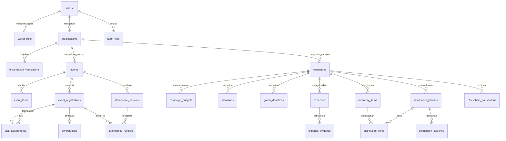

# Model Data — AksiBareng

Sumber kebenaran skema adalah `prisma/schema.prisma`. Dokumen ini menjelaskan **maksud** setiap tabel, enum, dan constraint yang wajib ada. Bila kode dan dokumen berbeda, dokumen ini yang harus diperbaiki lebih dulu (lihat `AGENTS.md`).

Entitas dasar mengikuti `docs/PRD.md` §11. Tabel bertanda _(internal)_ adalah tambahan implementasi yang tidak ada di PRD.

## 1. Konvensi

| Aspek | Aturan |
|---|---|
| Primary key | `id UUID` (v7 bila tersedia, agar urut waktu) |
| Nama tabel | `snake_case` plural (`event_registrations`), dipetakan via `@@map` |
| Nama field | `camelCase` di Prisma |
| Waktu | `timestamptz`, selalu UTC di DB |
| Nominal token | `numeric(78,0)` — wei sebagai integer; **tidak pernah** float |
| Nominal fiat (bila ada) | `numeric(18,2)` + kolom mata uang eksplisit |
| Soft delete | Tidak dipakai. Gunakan status (`CANCELLED`, `REVOKED`) + audit log |
| Mutasi penting | Wajib menulis `audit_logs` dalam transaksi yang sama |
| ID publik | UUID internal; `slug` hanya untuk URL, tanpa data pribadi |

## 2. ERD ringkas



## 3. Identitas & akses

### `users`
| Kolom | Tipe | Aturan |
|---|---|---|
| `id` | uuid | PK |
| `email` | text | unik (case-insensitive), wajib |
| `password_hash` | text | Argon2id, tidak pernah dikirim ke klien |
| `display_name` | text | 2–60 karakter |
| `role` | enum `UserRole` | `VOLUNTEER`, `ORGANIZER`, `ADMIN`; default `VOLUNTEER` |
| `is_public_name` | boolean | default `true`; bila `false` tampil "Donatur anonim" |
| `status` | enum `UserStatus` | `ACTIVE`, `SUSPENDED`, `DELETED` |
| `last_login_at` | timestamptz | null |
| `created_at` / `updated_at` | timestamptz | |

Tidak ada kolom role ganda: satu akun satu role utama. Pengguna yang berdonasi dan menjadi relawan tetap `VOLUNTEER`; donasi tidak memerlukan role khusus (PRD §4.2). Naik ke `ORGANIZER` hanya lewat persetujuan `organization_verifications` (AUTH-05/06).

### `wallet_links`
`id`, `user_id` FK, `address` (hex 20 byte, disimpan lowercase), `chain_id` int, `status` enum `WalletLinkStatus` (`PENDING`, `VERIFIED`, `REVOKED`), `nonce` text, `message` text, `signature` text, `verified_at`, `created_at`.
Constraint: `UNIQUE(lower(address), chain_id)` — satu wallet tidak boleh diklaim dua akun.

### `organizations`
`id`, `owner_id` FK users, `name`, `slug` unik, `description`, `category_id` FK categories, `contact_email`, `public_area` (kota/kabupaten/provinsi — **bukan** alamat rumah), `logo_url`, `website`, `verification_status` enum `VerificationStatus`, `created_at`, `updated_at`.
Status default `UNVERIFIED`. Hanya `VERIFIED` yang boleh menerbitkan kampanye publik (CAM-01).

### `organization_verifications`
`id`, `organization_id` FK, `submitted_by` FK users, `document_storage_key`, `document_sha256`, `document_salt`, `status` enum `VerificationStatus`, `reviewer_id` FK users null, `review_note`, `submitted_at`, `reviewed_at`.
Rekaman lama tidak ditimpa; pengajuan ulang membuat baris baru.

## 4. Kegiatan & relawan (AksiKegiatan)

### `events`
`id`, `organization_id` FK, `title`, `slug` unik, `description`, `category_id`, `location_name`, `public_address` (lokasi umum kegiatan), `city`, `starts_at`, `ends_at`, `quota` int > 0, `registration_opens_at`, `registration_closes_at`, `cancellation_deadline`, `status` enum `EventStatus`, `cancel_reason`, `created_by`, `created_at`, `updated_at`.

Constraint: `CHECK (ends_at > starts_at)`, `CHECK (registration_closes_at >= registration_opens_at)`, `CHECK (quota BETWEEN 1 AND 5000)`.

### `event_registrations` (EVT-06…09)
`id`, `event_id`, `user_id`, `status` enum `RegistrationStatus`, `registered_at`, `cancelled_at`, `cancel_reason`.
Constraint: `UNIQUE(event_id, user_id)`.

**Penegakan kuota:** pendaftaran dijalankan dalam satu transaksi:
```sql
SELECT id, quota, status, registration_opens_at, registration_closes_at
FROM events WHERE id = $1 FOR UPDATE;
SELECT count(*) FROM event_registrations
WHERE event_id = $1 AND status IN ('REGISTERED','CHECKED_IN','VERIFIED');
```
Bila `count >= quota` → `409 QUOTA_FULL`. Lock baris event mencegah oversubscription (acceptance EVT-08).

### `event_tasks` (SCH-01, SCH-02)
`id`, `event_id`, `name`, `description`, `quota` int > 0, `sort_order`.

### `task_assignments` (SCH-03, SCH-04, SCH-06)
`id`, `task_id`, `registration_id`, `assigned_by`, `assigned_at`, `notes`.
Constraint: `UNIQUE(registration_id)` — satu relawan satu penempatan aktif; perubahan menimpa dengan riwayat di `audit_logs`. Penempatan ditolak bila jumlah assignment tugas ≥ `event_tasks.quota`.

### `attendance_sessions` (ATT-01)
`id`, `event_id`, `opened_by`, `opens_at`, `closes_at`, `status` enum `AttendanceSessionStatus` (`OPEN`, `CLOSED`), `created_at`.
Satu event boleh punya beberapa sesi (mis. check-in pagi & sore); hanya satu `OPEN` per event (partial unique index).

### `attendance_records` (ATT-03…05)
`id`, `session_id`, `registration_id`, `token_nonce` text, `checked_in_at`, `checked_in_by`, `method` enum `CheckInMethod` (`QR`, `MANUAL`).
Constraint: `UNIQUE(session_id, registration_id)` dan `UNIQUE(token_nonce)`.
Token QR = `base64url(payload) + "." + HMAC-SHA256(payload, QR_TOKEN_SECRET)`, payload berisi `registrationId`, `sessionId`, `nonce`, `exp`. Tidak disimpan sebagai rahasia; `token_nonce` menandai pemakaian sehingga replay ditolak `409`.

### `contributions` (ATT-06…08)
`id`, `event_id`, `registration_id` unik, `user_id`, `status` enum `ContributionStatus` (`PENDING`, `VERIFIED`, `REVOKED`), `validated_by`, `validated_at`, `revoked_by`, `revoke_reason`, `blockchain_tx_id` FK null, `created_at`.
Hanya boleh dibuat bila registrasi berstatus `CHECKED_IN`. Check-in tidak otomatis membuat kontribusi terverifikasi (acceptance ATT-06).

## 5. Kampanye & donasi (AksiPeduli)

### `campaigns` (CAM-01…08)
| Kolom | Tipe | Catatan |
|---|---|---|
| `id` | uuid | |
| `organization_id` | uuid | FK |
| `title`, `slug`, `story` | text | `slug` unik |
| `category_id` | uuid | |
| `period_starts_at`, `period_ends_at` | timestamptz | |
| `target_amount_wei` | numeric(78,0) | target donasi testnet |
| `target_amount_idr_label` | numeric(18,2) null | hanya **label ilustratif**, tidak dipakai perhitungan |
| `funding_asset` | enum `FundingAsset` | `NATIVE_ETH_TESTNET` pada MVP |
| `general_location` | text | kota/kabupaten, tanpa alamat penerima |
| `status` | enum `CampaignStatus` | lihat §7 |
| `reviewed_by`, `reviewed_at`, `review_note` | | jejak admin |
| `on_chain_campaign_id` | integer null | ID di kontrak |
| `closed_reason`, `final_report_storage_key` | | CAM-08 |

Constraint: `CHECK (period_ends_at > period_starts_at)`.

### `campaign_budgets` (CAM-03)
`id`, `campaign_id`, `version` int, `category`, `description`, `planned_amount_wei` numeric(78,0), `created_by`, `created_at`, `superseded_at` null.
Aturan: revisi anggaran membuat versi baru; versi lama diberi `superseded_at` dan tetap ada (audit trail, CAM acceptance).

### `donations` (DON-01…07)
`id`, `campaign_id`, `donor_user_id` null (donasi bisa dari akun terhubung wallet tanpa profil lengkap), `donor_display_name`, `is_anonymous` bool, `amount_wei` numeric(78,0), `chain_id`, `tx_hash` null, `status` enum `DonationStatus` (`INTENT`, `PENDING`, `CONFIRMED`, `FAILED`), `donation_intent_nonce` unik, `confirmed_at`, `created_at`.
Constraint: `UNIQUE(chain_id, tx_hash)` (partial, saat `tx_hash` tidak null) — mencegah pencatatan ganda transaksi yang sama.

### `goods_donations` (GDS-01…03)
`id`, `campaign_id`, `donor_user_id` null, `donor_display_name`, `item_name`, `category`, `quantity` int > 0, `unit`, `condition` enum `GoodsCondition` (`NEW`, `LIKE_NEW`, `USED_GOOD`), `note`, `handover_method` enum (`DROP_OFF`, `PICKUP_BY_ORGANIZER`, `COURIER`), `status` enum `GoodsDonationStatus` (`SUBMITTED`, `ACCEPTED`, `REJECTED`, `RECEIVED`, `CANCELLED`), `received_quantity` int null, `received_by`, `received_at`, `reject_reason`.

### `inventory_items` (GDS-04…06)
`id`, `campaign_id`, `name`, `category`, `unit`, `quantity_received`, `quantity_allocated`, `quantity_distributed`, `expires_at` null, `updated_at`.
Constraint: `CHECK (quantity_received >= 0 AND quantity_allocated >= 0 AND quantity_distributed >= 0)`, `CHECK (quantity_allocated <= quantity_received)`, `CHECK (quantity_distributed <= quantity_allocated)`.
`quantity_remaining = quantity_received - quantity_allocated` — dihitung di query, bukan kolom tersimpan, agar tidak bisa desinkron.

### `expenses` (EXP-01…05)
`id`, `campaign_id`, `category`, `amount_wei` numeric(78,0) > 0, `description`, `payee_name`, `created_by`, `status` enum `ExpenseStatus` (`PROPOSED`, `APPROVED`, `REJECTED`, `PAID`), `reviewer_id`, `reviewed_at`, `review_note`, `paid_at`, `payment_reference`, `blockchain_tx_id` null, `created_at`.
Aturan aplikasi: total `APPROVED` + `PAID` tidak boleh melebihi dana terkonfirmasi + saldo awal yang dinyatakan; pelanggaran → `409 EXPENSE_EXCEEDS_FUNDS`. Pengaju tidak boleh menjadi reviewer bila `campaign.require_dual_approval` (P1).

### `expense_evidence` (EXP-04)
`id`, `expense_id`, `storage_key`, `file_name`, `mime_type`, `size_bytes`, `sha256`, `chain_hash` (keccak256), `document_salt`, `uploaded_by`, `uploaded_at`, `anchor_status` enum `AnchorStatus` (`NOT_ANCHORED`, `PENDING`, `CONFIRMED`, `FAILED`, `RETRY_REQUIRED`).

## 6. Distribusi bantuan

### `distribution_batches` (DST-01…07)
`id`, `campaign_id`, `title`, `aid_type` enum `AidType` (`GOODS`, `FUNDS`), `general_location`, `planned_date`, `dispatched_at`, `delivered_at`, `person_in_charge_id`, `status` enum `DistributionStatus`, `notes`, `verified_by`, `verified_at`, `blockchain_tx_id` null, `created_at`.

### `distribution_items` (DST-03, DST-06)
`id`, `batch_id`, `inventory_item_id` null, `description`, `unit`, `quantity_planned`, `quantity_dispatched`, `quantity_received`.
Constraint: `CHECK (quantity_dispatched <= quantity_planned)`, `CHECK (quantity_received <= quantity_dispatched)`.
Alokasi barang menaikkan `inventory_items.quantity_allocated` dalam transaksi yang sama; jika melebihi stok → `409 INSUFFICIENT_STOCK`.

### `distribution_evidence` (DST-04)
`id`, `batch_id`, `storage_key`, `mime_type`, `sha256`, `chain_hash`, `document_salt`, `captured_by`, `captured_at`, `privacy_review` enum `PrivacyReview` (`PENDING`, `APPROVED`, `REDACTED`, `REJECTED`), `anchor_status`.
Foto wajah/alamat penerima wajib `REDACTED` sebelum dipublikasikan; bila `PENDING`, hanya terlihat oleh organizer & admin.

## 7. Enum status

| Enum | Nilai | Dipakai untuk |
|---|---|---|
| `UserRole` | `VOLUNTEER`, `ORGANIZER`, `ADMIN` | AUTH-03 |
| `UserStatus` | `ACTIVE`, `SUSPENDED`, `DELETED` | moderasi |
| `VerificationStatus` | `UNVERIFIED`, `PENDING`, `VERIFIED`, `REJECTED`, `SUSPENDED` | AUTH-05/06 |
| `WalletLinkStatus` | `PENDING`, `VERIFIED`, `REVOKED` | AUTH-07 |
| `EventStatus` | `DRAFT`, `PUBLISHED`, `ONGOING`, `COMPLETED`, `CANCELLED` | EVT-01/03/11 |
| `RegistrationStatus` | `REGISTERED`, `CANCELLED`, `CHECKED_IN`, `VERIFIED`, `NO_SHOW`, `REJECTED` | EVT-06, ATT-07 |
| `AttendanceSessionStatus` | `OPEN`, `CLOSED` | ATT-01 |
| `CheckInMethod` | `QR`, `MANUAL` | ATT-03 |
| `ContributionStatus` | `PENDING`, `VERIFIED`, `REVOKED` | ATT-06/08 |
| `CampaignStatus` | `DRAFT`, `PENDING_REVIEW`, `ACTIVE`, `PAUSED`, `CLOSED`, `COMPLETED`, `REJECTED`, `CANCELLED` | CAM-04/08 |
| `FundingAsset` | `NATIVE_ETH_TESTNET` | DON-02 |
| `DonationStatus` | `INTENT`, `PENDING`, `CONFIRMED`, `FAILED` | DON-03/05 |
| `GoodsDonationStatus` | `SUBMITTED`, `ACCEPTED`, `REJECTED`, `RECEIVED`, `CANCELLED` | GDS-03 |
| `GoodsCondition` | `NEW`, `LIKE_NEW`, `USED_GOOD` | GDS-02 |
| `ExpenseStatus` | `PROPOSED`, `APPROVED`, `REJECTED`, `PAID` | EXP-03 |
| `DistributionStatus` | `PLANNED`, `PREPARED`, `DISPATCHED`, `DELIVERED`, `VERIFIED`, `PARTIALLY_DELIVERED`, `CANCELLED`, `NEEDS_REVIEW` | DST status |
| `AidType` | `GOODS`, `FUNDS` | DST-02 |
| `PrivacyReview` | `PENDING`, `APPROVED`, `REDACTED`, `REJECTED` | DST privacy |
| `TxKind` | `DONATION`, `ISSUE_CONTRIBUTION`, `REVOKE_CONTRIBUTION`, `RECORD_EXPENSE_PROOF`, `RECORD_DISTRIBUTION`, `CREATE_CAMPAIGN`, `CLOSE_CAMPAIGN` | `blockchain_transactions` |
| `TxStatus` | `PENDING`, `CONFIRMED`, `FAILED`, `RETRY_REQUIRED` | PRD §13.3 |
| `AnchorStatus` | `NOT_ANCHORED`, `PENDING`, `CONFIRMED`, `FAILED`, `RETRY_REQUIRED` | bukti |

Transisi status yang diizinkan ada di `docs/FLOWS.md` §3.

## 8. Jejak audit & operasional

### `audit_logs`
`id` bigserial, `actor_user_id` null, `actor_role`, `action` (mis. `campaign.updated`), `entity_type`, `entity_id`, `before` jsonb, `after` jsonb, `reason` text null, `request_id`, `ip_hash` (hash, bukan IP mentah), `created_at`.
Indeks: `(entity_type, entity_id, created_at DESC)`, `(actor_user_id, created_at DESC)`.
Yang **wajib** menulis audit log: perubahan kuota/anggaran/target, verifikasi organisasi, keputusan review kampanye, validasi/revokasi kontribusi, perubahan stok, keputusan pengeluaran, perubahan status distribusi, perubahan role.

### `blockchain_transactions`
`id`, `chain_id`, `contract_address`, `kind` enum `TxKind`, `reference_type`, `reference_id` (uuid), `idempotency_key` unik, `tx_hash` null, `status` enum `TxStatus`, `attempts` int default 0, `last_error`, `block_number`, `log_index`, `submitted_by`, `confirmed_at`, `created_at`, `updated_at`.
Constraint: partial `UNIQUE(chain_id, tx_hash, log_index)`.
`idempotency_key` dibentuk dari `kind:referenceId` sehingga retry tidak menerbitkan catatan ganda.

### `indexer_cursors` _(internal)_
`chain_id` + `contract_address` (PK gabungan), `last_block` bigint, `updated_at`. Dipakai cron untuk melanjutkan pembacaan event.

### `categories` & `platform_settings` _(internal)_
`categories`: `id`, `scope` enum (`EVENT`, `CAMPAIGN`, `EXPENSE`), `name`, `slug`, `is_active`.
`platform_settings`: `key` PK, `value` jsonb, `updated_by`, `updated_at` (mis. `required_confirmations`, `max_upload_bytes`).

### `abuse_reports` (CAM-09, P1)
`id`, `reporter_user_id` null, `target_type` enum (`CAMPAIGN`, `EVENT`), `target_id`, `reason`, `details`, `status` enum (`OPEN`, `REVIEWING`, `RESOLVED`, `DISMISSED`), `handled_by`, `handled_at`, `created_at`.

## 9. Aturan data agregat untuk laporan (TRN-01…05)

Dihitung, tidak disimpan ganda:

```sql
-- dana terkumpul (hanya yang terkonfirmasi)
SELECT coalesce(sum(amount_wei), 0) FROM donations
WHERE campaign_id = $1 AND status = 'CONFIRMED';

-- dana digunakan (disetujui + dibayar)
SELECT coalesce(sum(amount_wei), 0) FROM expenses
WHERE campaign_id = $1 AND status IN ('APPROVED','PAID');

-- sisa dana = terkumpul - digunakan
```
Angka chain dan angka DB ditampilkan bersebelahan bila berbeda, dengan label sumber (`Dari blockchain` / `Dari catatan organizer`) sesuai PRD §7.10.

## 10. Aturan seed & data demo

- Semua nama, email, dan nomor telepon fiktif; domain email `@aksibareng.test`.
- Jangan menyertakan data penerima bantuan yang dapat diidentifikasi. Gunakan "Keluarga A (Cilacap)" tanpa alamat.
- Wallet demo: alamat testnet yang dihasilkan dari seed phrase yang **hanya** ada di mesin presenter, tidak di repo.
- Seed harus idempoten (`upsert` berdasarkan `slug`/`email`) sehingga demo bisa dijalankan ulang.
