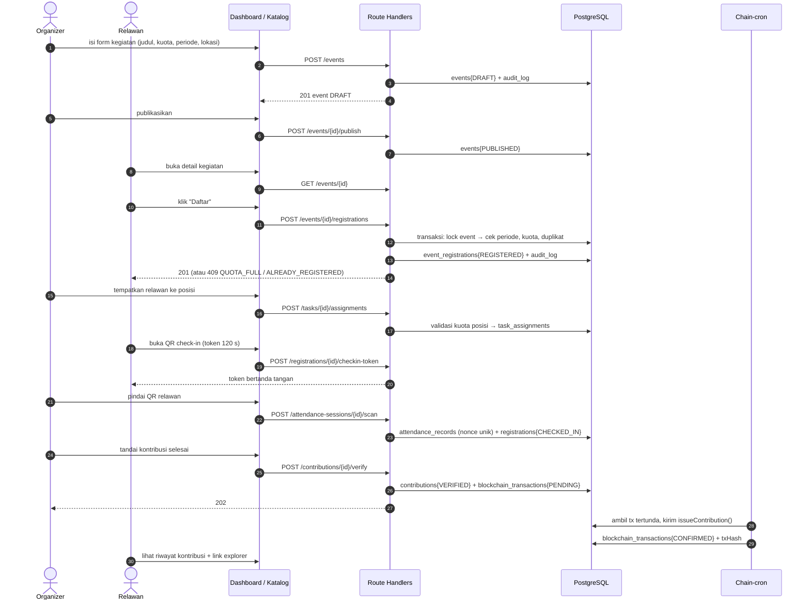
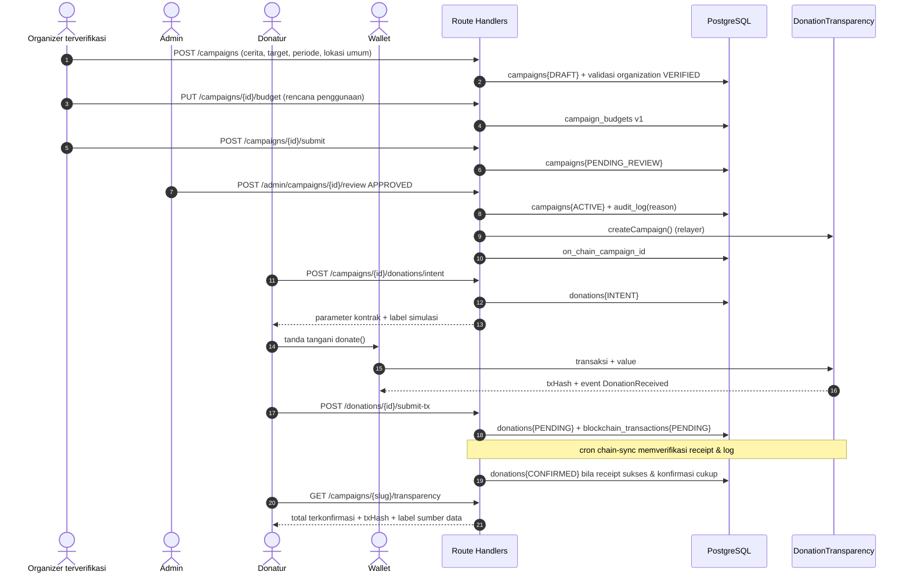
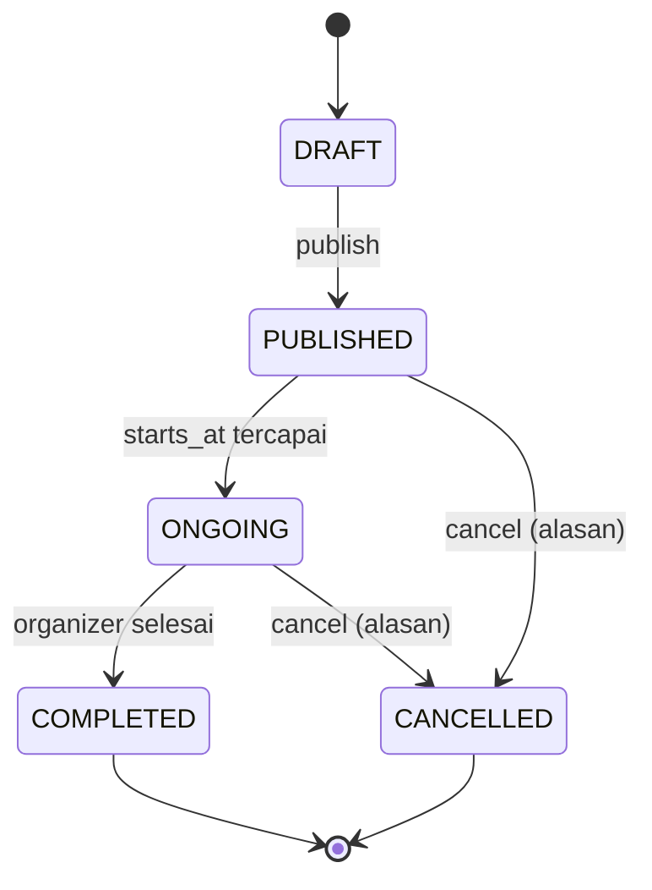
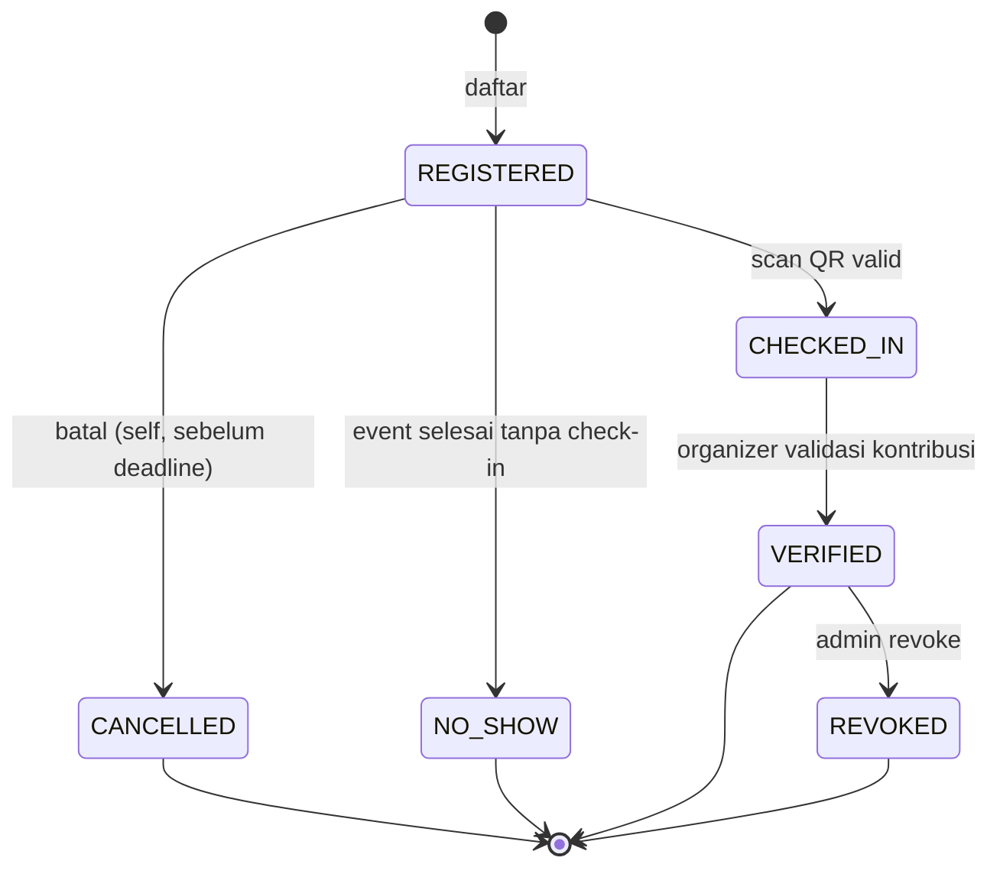
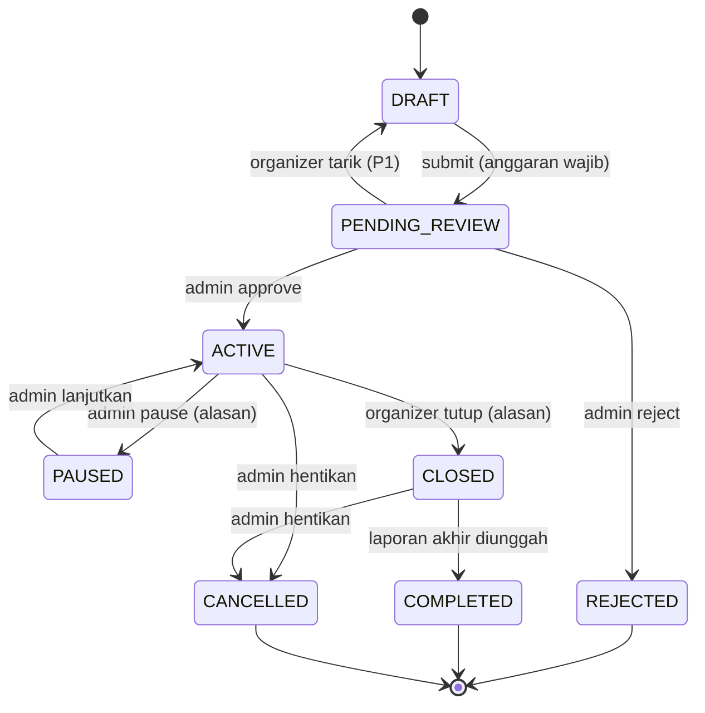
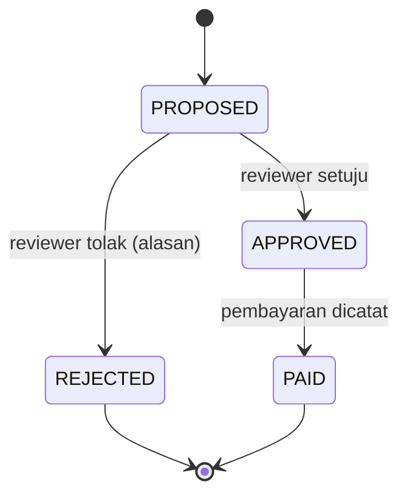
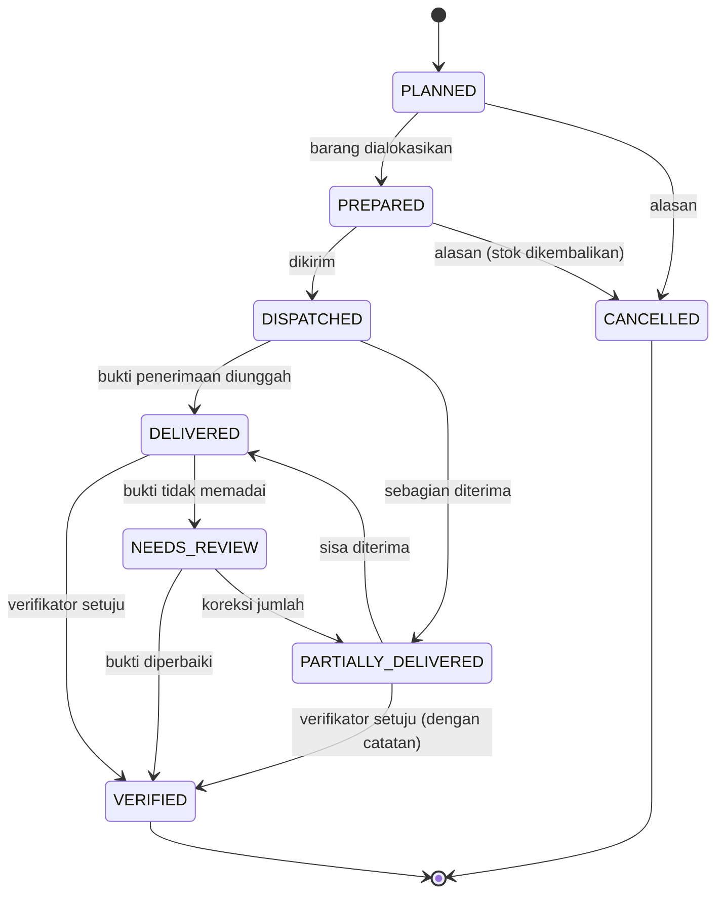
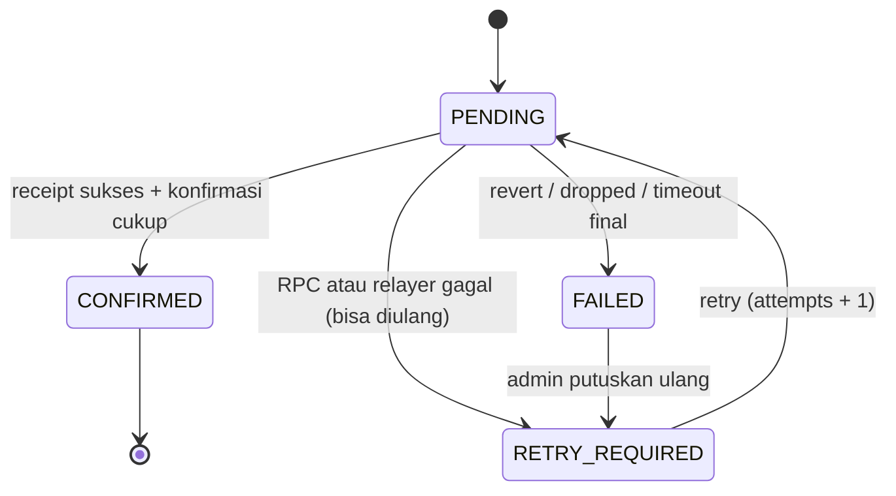

# Alur & State Machine — AksiBareng

Sequence diagram untuk empat flow PRD §8 dan aturan transisi status. Tujuan dokumen ini: implementasi tidak menebak urutan dan tidak mengizinkan lompatan status.

## 1. Flow A — Organizer membuat kegiatan & mengelola relawan

Catatan: check-in **tidak** membuat kontribusi terverifikasi. Bila chain gagal, `contributions.status` tetap `VERIFIED` dan `onChain` menjadi `RETRY_REQUIRED`.

## 2. Flow B — Membuat & mendanai kampanye

Penolakan admin: `REJECTED` + `review_note`; kampanye tidak bisa diedit lagi kecuali dikembalikan ke `DRAFT` lewat endpoint khusus (P1). Pada MVP, organizer membuat kampanye baru.

## 3. State machine

### 3.1 Kegiatan & pendaftaran

| Dari | Ke | Syarat |
|---|---|---|
| `DRAFT` | `PUBLISHED` | >= 1 kategori, kuota > 0, periode valid, `starts_at` di masa depan |
| `PUBLISHED` | `CANCELLED` | alasan wajib; semua peserta `REGISTERED` menerima notifikasi in-app (P1) |
| `PUBLISHED`/`ONGOING` | `COMPLETED` | hanya setelah `ends_at` |

Registrasi:

Aturan: `REGISTERED → VERIFIED` langsung **dilarang**; `CANCELLED → CHECKED_IN` dilarang; `VERIFIED` hanya setelah `CHECKED_IN`.

### 3.2 Kampanye

Aturan: donasi hanya diterima saat `ACTIVE`. `CLOSED` masih boleh membaca laporan; `COMPLETED` wajib punya `final_report_storage_key`.

### 3.3 Pengeluaran

Aturan: `PROPOSED → PAID` dilarang (harus melewati `APPROVED`). Menandai `PAID` tidak otomatis berarti on-chain; `blockchain_tx_id` menangani anchor hash bukti.

### 3.4 Distribusi

Aturan: `VERIFIED` hanya oleh verifikator/admin (DST-05); alokasi melebihi stok ditolak sebelum `PREPARED`; foto tanpa `privacy_review` final tidak tampil publik.

### 3.5 Transaksi blockchain & anchor

Aturan: `RETRY_REQUIRED` tetap menyimpan `last_error`; `attempts` maksimal 5 lalu menjadi `FAILED` dan butuh keputusan admin. `FAILED` **tidak** menghapus data bisnis.

## 4. Titik keputusan penting

| Titik | Keputusan MVP | Konsekuensi |
|---|---|---|
| Pembatalan kegiatan | Peserta mendapat status `CANCELLED` + alasan tampil di halaman | Tidak ada refund otomatis (tidak ada dana) |
| Pendaftaran penuh | Ditolak, tanpa waitlist | Sederhana & dapat diuji |
| Check-in | Token 120 detik, sekali pakai, hanya organizer memindai | Anti replay, tanpa perangkat khusus |
| Verifikasi kontribusi | Manual oleh organizer | Human verification (PRD §5) |
| Donasi uang | Testnet native ETH | Wajib label simulasi |
| Pembayaran pengeluaran | Dicatat manual + bukti | Tidak ada integrasi bank |
| Verifikasi distribusi | Koordinator/admin | Relawan tidak dapat memverifikasi |
| Laporan akhir | Wajib sebelum `COMPLETED` | Kelengkapan laporan terukur (METRICS) |

## 5. Checklist implementasi alur

- [ ] Setiap transisi status punya fungsi tunggal di `lib/workflow/` (bukan logika tersebar di route).
- [ ] Transisi yang tidak terdaftar mengembalikan `409 INVALID_STATE_TRANSITION`.
- [ ] Setiap transisi menulis `audit_logs` dengan `before`/`after`.
- [ ] Alur demo (Flow A & B) berjalan end-to-end tanpa langkah manual di database.
- [ ] Kegagalan chain tidak memblokir langkah berikutnya di UI; status ditampilkan jujur.
